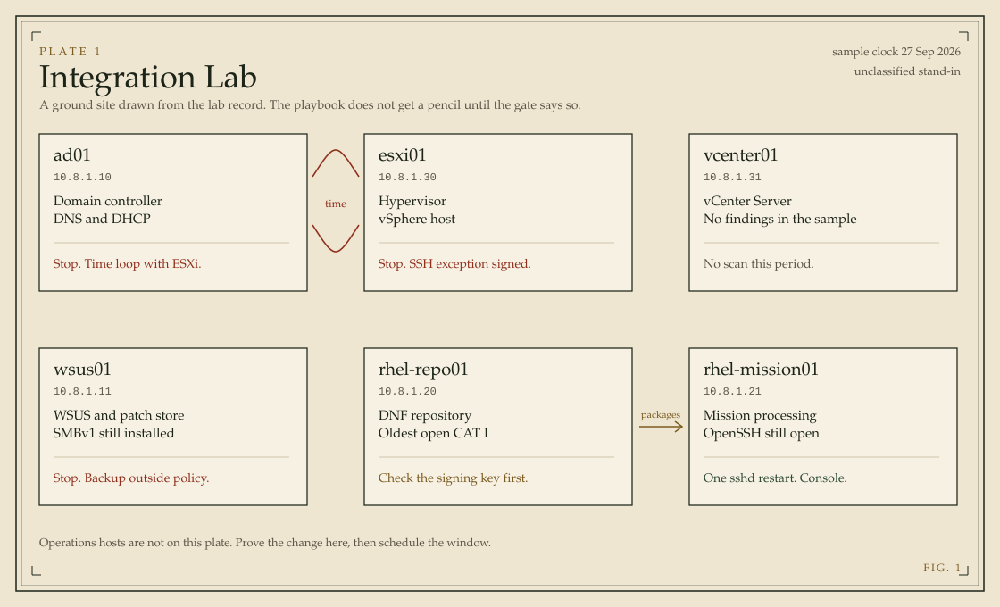
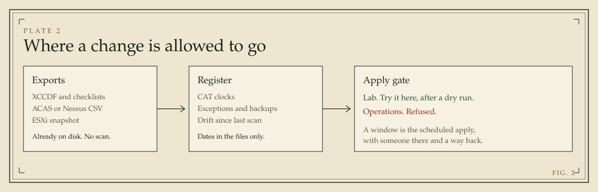

# Findings Register


A findings register for the exports an enclave already produces. You give it OpenSCAP or SCC XCCDF, a STIG Viewer checklist, an ACAS or Nessus CSV, and a read-only vSphere snapshot (ESXi, vCenter, or a VM). It gives back CAT clocks, drift, exceptions, a backup check, and an evidence pack.

Shops already do this in Excel, eMASS, ACAS, SCC, and Evaluate-STIG. This does not replace those tools and it does not scan anything. It is the transcription after the exports exist: which rows are still open, which clock they are on, which ones are safe to hand to Ansible, and which ones are not.

There is no model and no network call. The result is the rule ids and the dates in the files.





The part that is not another tracker: `ansible/generated/apply-gate.json`. The playbook reads it before editing a file and stops when a signed exception is still in force, two hosts take time from each other, a disruptive change lands on a backup that missed its policy, a pass depends on another host that is still failing, a predecessor check such as `rpm -q gpg-pubkey` fails, or one restart would land before the rest of that service's changes. A host with no scan this period is not treated as clean. The stop for a signature lifts the day after the exception expires.

Integration Lab, the sample, is an unclassified stand-in for a small ground site: one domain controller (DNS and DHCP), WSUS, a RHEL 8 repository, one mission host, and vSphere. The scan files are synthetic. Rule identifiers that include a vulnerability number are public STIG identifiers. Titles and results were written for this lab. The register does not redistribute benchmark text.

## Run the sample

```bash
python3 -m pytest
python3 -m findings demo --out web/src/data/ledger.json --evidence dist/evidence
cd web && npm install && npm run dev -- --port 43123 --hostname 0.0.0.0
```

The sample clock is pinned to 27 Sep 2026 so the overdue rows stay overdue when someone clones the repo later. Pass `--today` to move it.

Try a change without touching that record:

```bash
python3 -m findings rehearse
```

That copies the lab inputs, moves one fact at a time, and writes `dist/window/report.md`. It does not write `fixtures/lab`, `web/src/data/ledger.json`, or `ansible/generated/apply-gate.json`. `dist/` is gitignored. Pass `--publish` when the Test window page should match the run you just made.

The four cases are the WSUS backup brought back inside policy, the ESXi SSH exception dated yesterday, the lab signing key marked imported, and that same key with the repository host marked operations. The operations case stays refused. The playbook inventory is the lab, and a host with `findings_tier=production` fails before any file is copied. A maintenance window is the scheduled time to apply a change the lab already proved, with someone at the console and a rollback.

Open the overview and read the note for the ISSO before the tables. The handoff page is red on purpose.

## Use your own exports

```bash
python3 -m findings ingest \
  --scan /path/to/exports \
  --hosts fixtures/lab/hosts.json \
  --exceptions fixtures/lab/exceptions.json \
  --backups fixtures/lab/backups.json \
  --services fixtures/lab/services.json \
  --site fixtures/lab/site.json \
  --milestones fixtures/lab/milestones.json \
  --policy policy/default.json \
  --today 2026-09-27 \
  --out ledger.json \
  --evidence dist/evidence
```

Put a date (`2026-09-20`) in checklist and CSV filenames. XCCDF uses `TestResult start-time`. JSON snapshots use `observed_at`.

Supported inputs:

- XCCDF 1.2 results, including the benchmark `Rule` block SCC and OpenSCAP write next to the results
- STIG Viewer CKL and STIG Viewer 3 / Evaluate-STIG CKLB, including severity override
- ACAS or Nessus CSV with a Host column, Risk, Plugin ID, CVE, and CVSS
- An ESXi, vCenter, or virtual machine snapshot from `vmware/collect_esxi_posture.py`. The top-level `kind` picks the checks: none or `esxi-posture` for an ESXi host, `vcenter-posture` for vCenter NTP, syslog forwarding, SSO lockout and password lifetime, and session timeout, and `vm-posture` for a VM's isolation and console settings, filed under its guest's host name. A field the snapshot did not read is not reviewed, not a pass.
- A Windows posture snapshot from `windows/Invoke-BaselineAudit.ps1 -Snapshot`, a `.json` whose `kind` is `windows-posture`

A `.nessus` XML file is not read. Export CSV from the console first.

Same finding, three identifiers. A checklist row `RHEL-08-010550` / `V-230296` and an XCCDF result `SV-230296r858711_rule` become one clock. ACAS is findings-only: a plugin that disappears while the host is still in the later file is closed. A host that is missing from the later file is not.

### Windows posture snapshot

`windows/Invoke-BaselineAudit.ps1 -Snapshot ad01_2026-09-27.json` writes a read-only JSON file and changes nothing. It records the host FQDN, `observed_at` in UTC, whether the host is a domain controller, the `w32tm /query /source` peer and Type, the FS-SMB1 state, where the password policy comes from (a GPO name or `local`), a pending reboot, and the WSUS target group and server. A probe that cannot run, such as `Get-WindowsFeature` on a client or anything that needs elevation, records null and a line in `probe_errors`. `-Snapshot` with `-Apply` or `-Revert` is refused.

Drop the file next to the other exports. A `.json` whose `kind` is `windows-posture` is read as Windows. A JSON file without `kind` is still read as an ESXi snapshot. SMBv1 fails when the feature is installed, and a pending reboot is noted in the detail. On a domain controller, a time source of `Local CMOS Clock`, `Free-running System Clock`, an empty answer, or a peer outside `allowed_time_sources` fails `WN22-DC-000060`. A null is not reviewed, never a pass. The password policy source is a note, not a finding.

The snapshot sees one host. It can show that the DC takes time from esxi01. It cannot show that esxi01 takes time from the DC, so `fixtures/lab/duties.json` still drives the time-loop stop in the gate.

## Verify the exports

The ledger records a sha256 and a size for every export it read. The evidence pack's `attestation.json` carries the same hashes, plus one `manifest_sha256` you can read aloud or write on a transfer form.

```bash
python3 -m findings verify --ledger web/src/data/ledger.json   --scan fixtures/lab/scans --attestation dist/evidence/attestation.json
```

Files are matched to the ledger by file name. Each row shows path, expected hash, actual hash, and ok, mismatch, missing, or extra.

Exit 0 means every source file matched and none were missing. An extra file is listed but does not fail the check. Exit 1 means at least one file changed or is missing, or the attestation disagrees with the ledger. The reasons are printed on stderr.

`manifest_sha256` is the sha256 of the sorted `<sha256>  <path>` lines, one per file. `sha256sum <files> | LC_ALL=C sort | sha256sum` gives the same value.

## Write results back into a checklist

STIG Viewer 3 and Evaluate-STIG write `.cklb`, which is JSON. The register reads it the same way it reads a `.ckl`: the host comes from `fqdn`, or `host_name` when `fqdn` is blank, and the date comes from the filename. A CKL row and a CKLB row for the same rule on the same host become one clock. A `.cklb` with no host or no rules stops the run like any other file that does not read.

To hand the register's view back to whoever owns the checklist:

```bash
python3 -m findings annotate --ledger web/src/data/ledger.json   --checklist fixtures/lab/scans/ad01_2026-09-20.ckl --out dist/ad01_2026-09-20.ckl
```

Each matched rule gets a block under a `--- findings register <date> ---` line in finding details and comments: clock, due date, CAT, the exception id if there is one, and the apply-gate decision and reason. Existing text stays above the line. STATUS is not changed, and rows the ledger does not hold are copied as they were. The command refuses to write over the input file. It reads `.ckl` and `.cklb`.

## What moved since last period

```bash
python3 -m findings delta --before last.json --after now.json --out dist/delta.md
```

Compares two ledgers and prints Markdown. The first line under the heading is a one-line count for a ticket. Sections, each "none" when empty:

- New open rows (not in the earlier ledger, or closed there)
- Closed since, and Closed without a rescan: closed, but no scan in its history after the earlier ledger's date
- Regressions, and Clock changes such as on_track to overdue
- Due within `--due-within` days (default: the policy's due_soon_days, else 21)
- Exceptions expiring within `--expiring-within` days (default 30), and exceptions that expired between the two dates
- Hosts missing from the period, including the later gate's unscanned list
- Gate decisions that changed, with both reasons, and backups that moved between ok and breach

Exit 0 always. Exit 2 when a ledger cannot be read.

## When a file does not read

The command stops. It prints the path and the reason, and it does not write a ledger.

That covers a broken XML file, a checklist with no findings, a CSV with no header, a CSV whose columns do not include Host, a blank host cell, a result value that is not Open / NotAFinding / Not_Applicable / Not_Reviewed / pass / fail, an empty directory, and a `.nessus` file. A file that failed is not treated as a host that passed.

Fix the export or re-export it, then rerun. The register will not guess a column or a status.

## Clocks and exceptions

`policy/default.json` is the ISSM's policy, not a guess baked into the code.

- CAT I 30 days, CAT II 90, CAT III 365
- STIG high / medium / low map to CAT I / II / III
- CVSS, for vulnerability exports only: 7.0 and above is CAT I, 4.0 and above is CAT II
- A regression restarts the clock
- An approved exception pauses it until the end date
- A pending exception does not
- The day after the end date, the finding is due

Classes on each open row:

| Class | Meaning |
| --- | --- |
| automate | Safe to hand to Ansible unattended, after a dry run |
| change-window | Restarts a service or reboots. One visit per host |
| gpo | Domain-joined. Fix the GPO, not the local policy |
| blocked | Closing it now would be a false pass |
| do-not-automate | A script would pass the scanner and break the mission, or violate a signed exception |

Backups are checked against `fixtures/lab/backups.json`. RPO is the age of the last good job, measured to noon on the sample clock. Each host keeps a `restore_tests` list, newest first: date, duration in minutes, what was restored, scope (`full`, `partial`, or `config-only`), the tester's role, `pass` or `fail`, and an optional ticket. Only a full restore that passed counts as a restore test. A config-only or partial restore, or a failed one, stays on the record but does not reset the clock, so the restore-test age is measured from the newest full pass, and a host with none is out of policy. RTO is read from how long the newest test actually took. A host breaches when RPO, restore-test age, the scope of the newest test, or RTO is missed, and every reason is listed in `dist/evidence/backups.md` and `backups.csv`. When `last_restore_test` disagrees with the newest entry, the entries win and the row is flagged.

## Controls

The Controls page lists the NIST SP 800-53 controls behind the CCIs the scanners reported, grouped by family, with each control's worst clock, its open, past-clock, and excepted counts, the earliest due date, and links to the findings under it. Control ids are normalized, so `AC-2 (1)` and `AC-02 (01)` are one control. A checklist row carries a CCI but no control id; it takes the control another scan in the same ledger reported for that CCI. A finding with no CCI, or with a CCI no scan tied to a control, is listed under `unmapped` so it does not drop out of the view. The evidence pack writes the same view twice: `controls.csv`, one row per control with the counts and the finding slugs joined by `;`, and `controls.md`, grouped by family with each finding's host and clock.

## Sign the gate

The playbook trusts `ansible/generated/apply-gate.json` only when an OpenSSH signature next to it verifies. Anyone can edit the JSON. Only the holder of the signing key can make it verify again. Needs OpenSSH 8.2 or newer on the controller.

```bash
ssh-keygen -t ed25519 -N "" -f ~/.ssh/findings-gate
cp ansible/allowed_signers.example ansible/allowed_signers
# replace the AAAA... line with: findings-register <contents of ~/.ssh/findings-gate.pub>
python3 -m findings demo --sign-key ~/.ssh/findings-gate
python3 -m findings verify-gate --gate ansible/generated/apply-gate.json   --allowed-signers ansible/allowed_signers --identity findings-register   --ledger web/src/data/ledger.json
```

`python3 -m findings sign --gate ansible/generated/apply-gate.json --key ~/.ssh/findings-gate` signs a gate that already exists. `ansible/site.yml` runs the same check on the controller before the role reads the gate. It stops when the signature is missing, the file was edited after signing, or the gate's `as_of` does not match the ledger's `generated_for`. `ingest` takes `--sign-key` too. `rehearse` never signs. `ansible/allowed_signers` and `*.sig` are gitignored. Keep the private key out of the repo.

## Try a change without applying it

The register never logs into a host. The Ansible role is separate, and the only unattended tags are the ones marked `automate`.

Dry run on one host. This prints the diff and writes nothing, including the backup:

```bash
ansible-playbook -i ansible/inventory/lab.ini ansible/site.yml \
  --check --diff \
  --limit rhel-repo01.lab.local \
  --tags gpgcheck,localpkg,pwquality
```

`gpgcheck`, `localpkg`, and `pwquality` edit files. `ssh-root` and `audit` are `change-window`: the first restarts sshd, the second installs a package. Leave them off an unattended run.

Apply the same tags on one host when the diff looks right:

```bash
ansible-playbook -i ansible/inventory/lab.ini ansible/site.yml \
  --limit rhel-repo01.lab.local \
  --tags gpgcheck,localpkg,pwquality
```

Before those edits, the role copies `/etc/yum.repos.d/*.repo`, `/etc/dnf/dnf.conf`, `/etc/security/pwquality.conf`, and `/etc/ssh/sshd_config` to `/var/backups/findings-register/<timestamp>/` and writes that path to `latest-path.txt`. A dry run does not create this copy.

## Prove the gate against a container

`ansible/molecule/` runs `site.yml` against a UBI 9 container named `rhel-repo01.lab.local`, the way an operator would. Each scenario signs its own gate with a throwaway key in Molecule's temporary directory, so nothing in the checkout is signed or changed. Needs Docker and Python 3.12 or newer.

```bash
python3 -m pip install ansible-core molecule "molecule-plugins[docker]"
cd ansible && molecule test -s unsigned   # also: refused, probe, allow
```

`unsigned` stops on the signature check before any role task. `refused` and `probe` stop at the refusal or at `rpm -q gpg-pubkey`. In all three there is no backup directory and every file keeps its sha256. `allow` stops `--tags ssh-root` without a window, applies gpgcheck, localpkg, and pwquality, checks the saved copies, then runs `revert.yml` and requires every file back byte for byte. CI runs all four.

## Put the file changes back

```bash
ansible-playbook -i ansible/inventory/lab.ini ansible/revert.yml \
  --limit rhel-repo01.lab.local
```

That restores the saved files. It does not restart sshd. It does not remove the audit package. If a config file did not exist before the run, and the play created it, revert deletes that file.

If sshd was restarted and you need the running daemon to pick up the restored file, do that from the console after you have read the file:

```bash
ansible-playbook -i ansible/inventory/lab.ini ansible/revert.yml \
  --limit rhel-repo01.lab.local \
  --tags restart-sshd
```

On Windows, `windows/Invoke-BaselineAudit.ps1` with no switches only reports. `-Apply` saves the FS-SMB1 install state and then removes the feature. `-Revert` reinstalls it only if that saved state says it was installed. `-Apply` and `-Revert` together are refused. Neither switch writes a password policy. On a domain member that change is a GPO.

## When something breaks

- GPG checking stops a package install when the key was never imported. The finding goes green and `dnf` starts failing. Revert the repo files, or import the key, then install again.
- Restarting sshd drops the session you used to restart it. That tag stays in a change window, with someone at the console. Revert restores `sshd_config` and leaves the daemon alone until you restart it on purpose.
- Removing SMBv1 wants a reboot before the finding is really closed. `-Revert` puts the feature back from the saved state and warns about the reboot. It cannot undo a reboot that already happened.
- The domain controller time finding is left alone. ESXi syncs from the DC and the DC syncs from ESXi. A script that "fixes" one side makes the other worse.
- ESXi SSH stays up when an exception says it is break-glass. Stopping it would violate that signature.

## What CI checks

CI runs on every push to master and every pull request. The Python job runs the test suite on 3.11, 3.12, and 3.13. One of those tests runs `python -m findings demo` and compares the gate it writes with `ansible/generated/apply-gate.json`. A change to the register that moves a decision fails that test and names the host and control, so the gate file is regenerated and reviewed in the same commit. The Ansible job runs yamllint, ansible-lint, and `ansible-playbook --syntax-check` on `site.yml` and `revert.yml`. PSScriptAnalyzer checks `windows/Invoke-BaselineAudit.ps1` for warnings and errors, the web job installs, lints, and builds the review UI, and a Molecule job runs the four container scenarios. An audit job runs pip-audit on the Python environment and the project, and `npm audit` on the web dependencies at critical severity. It is critical rather than high because Next 15 bundles a PostCSS that npm flags at high, and the fix is Next 16.

## What else is in the repo

- `ansible/` — RHEL role, the dry-run play, and `revert.yml`. Read `ansible/generated/lab-plan.yml` before you choose tags.
- `windows/Invoke-BaselineAudit.ps1` — report by default. `-Snapshot` writes a read-only JSON file the register reads. `-Apply` and `-Revert` only touch FS-SMB1.
- `vmware/collect_esxi_posture.py` — ESXi lockdown, SSH, NTP, and syslog; vCenter NTP, syslog forwarding, SSO lockout and password policy, and session timeout; VM isolation and console settings. Snapshot mode needs no vCenter. `--govc` runs read-only `govc` commands and refuses to guess if SSH or NTP is missing from the ESXi service list or a VM's advanced settings are missing from the output. vCenter appliance settings that govc cannot read are recorded as not reviewed.
- `docs/runbooks/` — the pages that exist. DHCP is missing on purpose, and the handoff gate says so.
- `ansible/molecule/` — four scenarios that run `site.yml` against a container and prove the gate stops it.
- `dist/evidence/` after `python3 -m findings demo` — POA&M CSV, per-host notes, drift, exceptions, the 800-53 control view, and an attestation that names and hashes the source files.

Python 3.11 or newer. The register uses the standard library only. The review UI is a Next.js app in `web/` and reads `web/src/data/ledger.json`.
